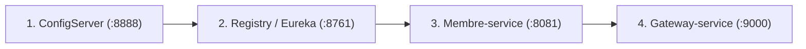

# Microservices Architecture (Spring Cloud)

Guide to set up and run this MSA project locally after cloning from GitHub.

---

### How to Run This MSA Project on Your Machine

Because this project uses Spring Cloud, the startup order of the applications is strict. You **must** start them in this exact order:



---

#### 0. Prerequisites (Before Running)

- **Java 17** installed (`java -version`).
- **Maven** installed (or use your IDE's Maven / Maven wrapper).
- **Git** installed (`git --version`).
- **VS Code Extensions (recommandées pour VS Code) :**
  - **Extension Pack for Java** (Microsoft)
  - **Spring Boot Extension Pack** (VMware)
- **Database:** This project uses an **H2 In-Memory Database**, so you **do not** need to install MySQL or any external database.

---

#### 1. Initialize the Configuration Repository (CRITICAL)

Because the `ConfigServer` reads configuration properties from a local Git repository, you must ensure it is initialized before starting the server.

1. Open a terminal inside the folder:
   ```bash
   cd ConfigServer/src/main/resources/myconfig
   ```

2. Run these commands:
   ```bash
   git init
   git branch -M master
   git add .
   git commit -m "first config"
   ```

> [!IMPORTANT]
> The `ConfigServer` expects the default Git branch to be `master`. Running `git branch -M master` guarantees compatibility even if your Git defaults to `main`.

---

#### 2. Start the Config Server

- **Dans VS Code :**
  - Ouvrez l'onglet **Exécuter et déboguer** (`Ctrl + Maj + D` ou l'icône de lecture/insecte à gauche).
  - Choisissez **"1. ConfigServerApplication (Port 8888)"** dans la liste déroulante et cliquez sur ▶️.
  - *(Ou ouvrez `ConfigServerApplication.java` et cliquez sur **Run** au-dessus de `main`)*.
- **Dans Eclipse / IntelliJ :** Lancez `ConfigServerApplication.java`.
- Attendez le message : `Tomcat started on port 8888`.
- **Test :** Ouvrez [http://localhost:8888/application/master](http://localhost:8888/application/master) dans votre navigateur. Vous devez voir un JSON avec `{"global": "..."}`.

---

#### 3. Start the Registry (Eureka)

- **Dans VS Code :** Lancez **"2. RegistryServiceApplication (Port 8761)"** depuis **Exécuter et déboguer** (ou ouvrez `RegistryServiceApplication.java` et cliquez sur **Run**).
- **Dans Eclipse / IntelliJ :** Lancez `RegistryServiceApplication.java`.
- Attendez le message : `Tomcat started on port 8761`.
- **Test :** Ouvrez [http://localhost:8761](http://localhost:8761). Vous devez voir le tableau de bord Eureka (*"No instances available"* pour l'instant).

---

#### 4. Start the Membre Microservice

- **Dans VS Code :** Lancez **"3. MembreServiceApplication (Port 8081)"** depuis **Exécuter et déboguer** (ou ouvrez `MembreServiceApplication.java` et cliquez sur **Run**).
- **Dans Eclipse / IntelliJ :** Lancez `MembreServiceApplication.java`.
- Attendez le message : `Tomcat started on port 8081`.
- **Test :** Rafraîchissez [http://localhost:8761](http://localhost:8761). Vous devez voir `MEMBRE-SERVICE` dans la liste des instances enregistrées.

---

#### 5. Start the Gateway

- **Dans VS Code :** Lancez **"4. GatewayServiceApplication (Port 9000)"** depuis **Exécuter et déboguer** (ou ouvrez `GatewayServiceApplication.java` et cliquez sur **Run**).
- **Dans Eclipse / IntelliJ :** Lancez `GatewayServiceApplication.java`.
- Attendez le message : `Tomcat started on port 9000` (ou Netty).
- **Test :** Rafraîchissez [http://localhost:8761](http://localhost:8761). Vous devez voir à la fois `MEMBRE-SERVICE` et `GATEWAY-SERVICE`.

---

#### 6. Final Test (The Gateway Route)

Do not call the Membre Service directly. Call it through the Spring Cloud Gateway:

- **Browser URL:** [http://localhost:9000/membres](http://localhost:9000/membres)

You should see the JSON list of students (`Ali` and `Sara`) returned successfully!

---

### Important Troubleshooting Notes

- **If ConfigServer crashes on startup:**
  Step 1 was skipped or incomplete. Make sure `ConfigServer/src/main/resources/myconfig` has been initialized as a Git repository and committed on branch `master`.
- **Si VS Code n'affiche pas le bouton "Run" ou indique des erreurs d'import :**
  - Appuyez sur `Ctrl + Maj + P`, tapez `Java: Clean Java Language Server Workspace`, puis choisissez **Restart and delete**.
  - Ou cliquez sur la vue **Java Projects** dans l'explorateur et faites un clic-droit sur le projet &rarr; **Update Project**.
- **Si Eclipse / IntelliJ indique "missing main type" :**
  - Clic-droit sur le projet &rarr; **Maven** &rarr; **Update Project**.
- **If the Gateway returns `503 Service Unavailable`:**
  The Gateway was started before `Membre-service`, or Eureka has not synced instances yet. Wait ~30 seconds for the heartbeat and refresh the page.
- **If the port is already in use (`Address already in use: bind`):**
  A previous instance is still running. Stop running processes via the IDE console (red square stop button) or kill the process using port `8888`, `8761`, `8081`, or `9000`.
"# dev-web" 
"# dev-web" 
"# dev" 
"# dev" 
